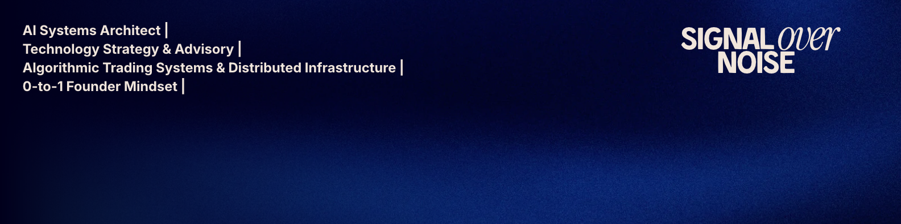

  

### Operating Thesis

Most builders optimize for demos; I optimize for systems that survive real-world constraints. Alongside studying **BSc (Hons) Computer Science with Artificial Intelligence** at the **University of York** (Merit Scholar) and running commercial P&L and supply-chain operations at **Bocadoh**, I design and ship full-stack software, semantic AI tools, and sensor-driven hardware.

---

### Selected Systems & Builds

| System | Architecture & Execution | Core Stack |
| :--- | :--- | :--- |
| **[DwarPod](https://github.com/kaavyagala/dwarpod)** | Enterprise attendance and focus terminal combining NFC tap authentication, parallel-alignment dual-camera Face ID verification, and automated distraction lockouts. | `Computer Vision` `NFC` `Python` `C++` |
| **[BONK](https://github.com/kaavyagala/bonk)** | Hardware-integrated pickleball telemetry platform featuring net-mounted impact sensors, tap triggers, real-time court scoring displays, and an MMR ranking engine. | `IoT Telemetry` `TypeScript` `Next.js` `Supabase` |
| **[DocuMind-AI](https://github.com/kaavyagala/documind-ai)** | Interactive document intelligence and research synthesis engine powered by dense SBERT embeddings, TF-IDF vectorization, and K-Means clustering. | `Python` `SBERT` `TF-IDF` `K-Means` `FastAPI` |
| **[Damru Platform](https://github.com/kaavyagala/damru)** | End-to-end event discovery, artist rollout, and registration web infrastructure engineered from scratch in three months to absorb peak live traffic with zero downtime. | `Next.js` `TypeScript` `Tailwind CSS` `Vercel` |

---

### Technical Stack

* **Languages & Core Systems:** `Python` · `TypeScript` · `C++` · `Rust` · `SQL`
* **AI & Data Architecture:** `FastAPI` · `LangGraph` · `SBERT` · `TF-IDF` · `K-Means` · `Edge Computer Vision`
* **Product & Interface Engineering:** `Next.js` · `React` · `Tailwind CSS` · `Framer Motion` · `Supabase` · `Figma`

---

### Engineering & Ecosystem Proof

* **Open-Source Velocity:** Completed **Hacktoberfest** in under **2 hours** with a 100% pull-request merge rate (Gold Badge); founded **DCode** to drive structured open-source engineering among student builders.
* **Commercial & Operational Scale:** Directing product R&D, vendor telemetry (20–30 suppliers), and multi-channel execution at **Bocadoh** (~10,000 units sold), applying systems thinking across both physical logistics and software.

---

  

